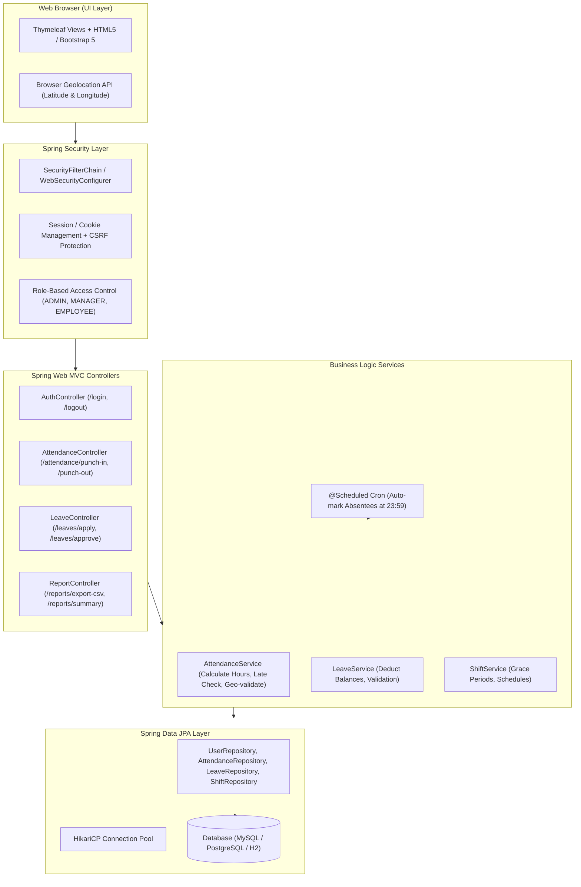
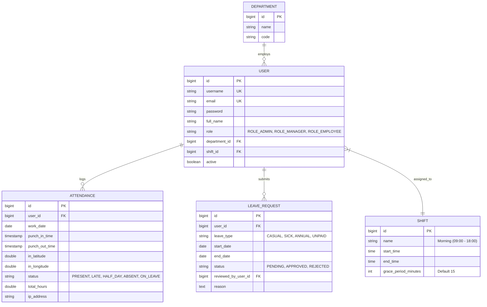

# Spring Boot Web Attendance Management System — Phased Development Guide

**Target Location:** `D:\Atish2`  
**Architecture:** Spring Boot MVC + Spring Data JPA + Spring Security + Thymeleaf / Bootstrap 5 + MySQL/PostgreSQL  
**Target Java Environment:** JDK 1.8 (Spring Boot 2.7.18) or JDK 17+ (Spring Boot 3.x)

---

## 1. Architecture Overview & High-Level Design



---

## 2. Recommended Project Directory Structure

Place the source tree directly within `D:\Atish2`:

```text
D:\Atish2\
├── pom.xml
├── src/
│   ├── main/
│   │   ├── java/com/atish/attendance/
│   │   │   ├── AttendanceApplication.java
│   │   │   ├── config/
│   │   │   │   ├── SecurityConfig.java
│   │   │   │   └── WebMvcConfig.java
│   │   │   ├── controller/
│   │   │   │   ├── AuthController.java
│   │   │   │   ├── DashboardController.java
│   │   │   │   ├── AttendanceController.java
│   │   │   │   ├── LeaveController.java
│   │   │   │   └── ReportController.java
│   │   │   ├── dto/
│   │   │   │   ├── PunchRequest.java
│   │   │   │   ├── LeaveApplyDto.java
│   │   │   │   └── AttendanceFilterDto.java
│   │   │   ├── entity/
│   │   │   │   ├── User.java
│   │   │   │   ├── Role.java
│   │   │   │   ├── Department.java
│   │   │   │   ├── Shift.java
│   │   │   │   ├── Attendance.java
│   │   │   │   └── LeaveRequest.java
│   │   │   ├── repository/
│   │   │   │   ├── UserRepository.java
│   │   │   │   ├── AttendanceRepository.java
│   │   │   │   ├── LeaveRequestRepository.java
│   │   │   │   └── ShiftRepository.java
│   │   │   ├── service/
│   │   │   │   ├── UserService.java
│   │   │   │   ├── AttendanceService.java
│   │   │   │   ├── LeaveService.java
│   │   │   │   ├── ReportService.java
│   │   │   │   └── ScheduledTasks.java
│   │   │   └── util/
│   │   │       ├── GeoUtils.java
│   │   │       └── CsvExportUtil.java
│   │   └── resources/
│   │       ├── application.properties
│   │       ├── static/
│   │       │   ├── css/style.css
│   │       │   └── js/attendance-geo.js
│   │       └── templates/
│   │           ├── layout/base.html
│   │           ├── auth/login.html
│   │           ├── dashboard/employee-dashboard.html
│   │           ├── dashboard/admin-dashboard.html
│   │           ├── attendance/punch.html
│   │           ├── attendance/history.html
│   │           ├── leaves/apply.html
│   │           ├── leaves/manage.html
│   │           └── reports/monthly-report.html
```

---

## 3. Database Schema & JPA Entity Design



---

## 4. Phase-by-Phase Development Roadmap

### Phase 1: Environment Setup & Maven Scaffolding
* **Objective:** Set up project scaffolding, dependencies, and database connection.
* **Tasks:**
  1. Set up `pom.xml` with:
     * `spring-boot-starter-web`
     * `spring-boot-starter-data-jpa`
     * `spring-boot-starter-security`
     * `spring-boot-starter-thymeleaf`
     * `thymeleaf-extras-springsecurity5` (or 6 for Boot 3)
     * `mysql-connector-j` (or PostgreSQL/H2)
     * `lombok` (optional for boilerplate reduction)
  2. Configure `src/main/resources/application.properties` with database URL, username, password, and `spring.jpa.hibernate.ddl-auto=update`.
  3. Verify the application starts on `http://localhost:8080`.
* **Deliverable:** Running Spring Boot application with successful database connectivity.

---

### Phase 2: JPA Entities, Repositories & Database Seeding
* **Objective:** Define all data models and auto-seed initial Admin/Manager accounts.
* **Tasks:**
  1. Create JPA entities: `User`, `Department`, `Shift`, `Attendance`, `LeaveRequest`.
  2. Create Spring Data interfaces: `UserRepository`, `AttendanceRepository`, `LeaveRequestRepository`, `ShiftRepository`.
  3. Create a `CommandLineRunner` or `@PostConstruct` bean `DataInitializer.java` to seed:
     * Default department: "Engineering", "Operations".
     * Default shift: 09:00 to 18:00 with 15 min grace period.
     * Default Admin user (`admin@company.com` / `admin123` hashed with BCrypt).
* **Deliverable:** Database tables automatically generated and populated with default seed records.

---

### Phase 3: Spring Security & Role-Based Access Control (RBAC)
* **Objective:** Secure the web application with login forms and role-specific access.
* **Tasks:**
  1. Implement `CustomUserDetailsService implements UserDetailsService` to load users and roles from the database.
  2. Configure `SecurityConfig.java`:
     * Public URLs: `/login`, `/css/**`, `/js/**`, `/images/**`.
     * Admin/HR URLs: `/admin/**`, `/departments/**`, `/shifts/**`.
     * Manager URLs: `/manager/**`, `/leaves/review/**`.
     * Employee URLs: `/attendance/**`, `/leaves/**`, `/dashboard`.
  3. Build modern login page in `src/main/resources/templates/auth/login.html` with error flash messages.
  4. Create role-based dashboard redirects after login.
* **Deliverable:** Secure authentication system with BCrypt password hashing and page protection.

---

### Phase 4: Core Web Attendance Engine (Punch In / Punch Out)
* **Objective:** Allow employees to clock in/out with automatic status and hour calculation.
* **Tasks:**
  1. Build Web Clock-in UI on `employee-dashboard.html` with dynamic clock and status badge.
  2. Implement browser Geolocation capture (`navigator.geolocation.getCurrentPosition`) in `attendance-geo.js`:
     * Captures browser coordinates upon clicking "Punch In".
     * Optional office geofence check (Haversine formula in `GeoUtils.java` to ensure distance ≤ 100m from office coordinates).
  3. In `AttendanceService.java`:
     * Prevent duplicate punch-in for the same day.
     * Compare `punch_in_time` with `Shift.startTime + gracePeriodMinutes`. If late, mark status `LATE`; otherwise `PRESENT`.
     * On "Punch Out", compute `total_hours` (e.g., `Duration.between(punchIn, punchOut).toMinutes() / 60.0`).
     * If `total_hours < 4`, flag as `HALF_DAY`.
* **Deliverable:** Functional Punch-In and Punch-Out workflow with real-time feedback and history view.

---

### Phase 5: Shift Scheduling, Grace Periods & Auto-Absent Cron
* **Objective:** Automate daily attendance processing and shift assignments.
* **Tasks:**
  1. Add `@EnableScheduling` to `AttendanceApplication.java`.
  2. Implement `ScheduledTasks.java`:
     * Runs daily at 23:59:00 (`@Scheduled(cron = "0 59 23 * * ?")`).
     * Finds all active employees with no attendance record and no approved leave for `LocalDate.now()`.
     * Automatically inserts an `Attendance` record with status `ABSENT` and `total_hours = 0`.
     * Finds open records with no `punch_out_time` and marks them with an "INCOMPLETE" warning flag for HR review.
* **Deliverable:** Fully automated daily status resolution with zero manual record creation needed for absentees.

---

### Phase 6: Leave Management & Approval Portal
* **Objective:** Enable employee leave applications and manager approval/rejection workflows.
* **Tasks:**
  1. Build Employee Leave Application Form (`/leaves/apply`):
     * Leave Type (Casual, Sick, Annual, Unpaid).
     * Start Date, End Date, Reason.
     * Client and server-side date validation (End Date ≥ Start Date).
  2. Build Manager Leave Review Portal (`/manager/leaves`):
     * List pending requests with employee details.
     * One-click "Approve" or "Reject" buttons with confirmation modal.
  3. Connect Leaves to Attendance:
     * When a leave is approved for date range `[start, end]`, pre-create or mark `Attendance.status = ON_LEAVE` so the cron task skips them.
* **Deliverable:** End-to-end leave application and manager authorization pipeline.

---

### Phase 7: Analytics, Reporting, CSV/Excel Export & Polish
* **Objective:** Provide management dashboards and timesheet export capabilities.
* **Tasks:**
  1. Build Manager/Admin Summary Dashboard:
     * Live daily attendance counter: Total Employees, Present, Late, Absent, On Leave.
     * Monthly attendance percentage chart per department.
  2. Implement Timesheet Filter & Export:
     * Filter by Department, Month, Year, and Status.
     * Export to CSV via `CsvExportUtil.java` or Excel via Apache POI.
  3. UI Polish:
     * Responsive Bootstrap 5 layout with sidebar navigation.
     * Flash messages (`RedirectAttributes.addFlashAttribute`) for success/error alerts.
     * Immutable audit logs for manual attendance corrections.
* **Deliverable:** Production-ready attendance management system ready for local run and deployment.

---

## 5. Starter `pom.xml` Specification

Save this configuration as `D:\Atish2\pom.xml`:

```xml
<?xml version="1.0" encoding="UTF-8"?>
<project xmlns="http://maven.apache.org/POM/4.0.0"
         xmlns:xsi="http://www.w3.org/2001/XMLSchema-instance"
         xsi:schemaLocation="http://maven.apache.org/POM/4.0.0 
         https://maven.apache.org/xsd/maven-4.0.0.xsd">
    <modelVersion>4.0.0</modelVersion>
    
    <parent>
        <groupId>org.springframework.boot</groupId>
        <artifactId>spring-boot-starter-parent</artifactId>
        <!-- Use 2.7.18 for Java 8 compatibility; or 3.2.x if running Java 17+ -->
        <version>2.7.18</version>
        <relativePath/>
    </parent>

    <groupId>com.atish</groupId>
    <artifactId>attendance-system</artifactId>
    <version>1.0.0</version>
    <name>Attendance Management System</name>
    <description>Enterprise Web-based Attendance Management System</description>

    <properties>
        <java.version>1.8</java.version>
    </properties>

    <dependencies>
        <!-- Spring Boot Starters -->
        <dependency>
            <groupId>org.springframework.boot</groupId>
            <artifactId>spring-boot-starter-web</artifactId>
        </dependency>
        <dependency>
            <groupId>org.springframework.boot</groupId>
            <artifactId>spring-boot-starter-data-jpa</artifactId>
        </dependency>
        <dependency>
            <groupId>org.springframework.boot</groupId>
            <artifactId>spring-boot-starter-security</artifactId>
        </dependency>
        <dependency>
            <groupId>org.springframework.boot</groupId>
            <artifactId>spring-boot-starter-thymeleaf</artifactId>
        </dependency>
        <dependency>
            <groupId>org.thymeleaf.extras</groupId>
            <artifactId>thymeleaf-extras-springsecurity5</artifactId>
        </dependency>

        <!-- Database Connectors -->
        <dependency>
            <groupId>com.mysql</groupId>
            <artifactId>mysql-connector-j</artifactId>
            <scope>runtime</scope>
        </dependency>
        <!-- In-memory H2 database for instant local development without MySQL setup -->
        <dependency>
            <groupId>com.h2database</groupId>
            <artifactId>h2</artifactId>
            <scope>runtime</scope>
        </dependency>

        <!-- Developer Tools & Boilerplate -->
        <dependency>
            <groupId>org.projectlombok</groupId>
            <artifactId>lombok</artifactId>
            <optional>true</optional>
        </dependency>
        <dependency>
            <groupId>org.springframework.boot</groupId>
            <artifactId>spring-boot-devtools</artifactId>
            <scope>runtime</scope>
            <optional>true</optional>
        </dependency>

        <!-- Testing -->
        <dependency>
            <groupId>org.springframework.boot</groupId>
            <artifactId>spring-boot-starter-test</artifactId>
            <scope>test</scope>
        </dependency>
        <dependency>
            <groupId>org.springframework.security</groupId>
            <artifactId>spring-security-test</artifactId>
            <scope>test</scope>
        </dependency>
    </dependencies>

    <build>
        <plugins>
            <plugin>
                <groupId>org.springframework.boot</groupId>
                <artifactId>spring-boot-maven-plugin</artifactId>
                <configuration>
                    <excludes>
                        <exclude>
                            <groupId>org.projectlombok</groupId>
                            <artifactId>lombok</artifactId>
                        </exclude>
                    </excludes>
                </configuration>
            </plugin>
        </plugins>
    </build>
</project>
```

---

## 6. Key Controller & View Mapping

| Endpoint | Method | View Template / Action | Description | Allowed Roles |
| :--- | :--- | :--- | :--- | :--- |
| `/login` | `GET` | `auth/login.html` | Login form | Public |
| `/dashboard` | `GET` | Role-based redirect | Directs user to employee or admin panel | Authenticated |
| `/attendance/punch` | `GET` | `attendance/punch.html` | Clock In/Out UI with live timer | `ROLE_EMPLOYEE` |
| `/attendance/punch-in` | `POST` | Redirect to `/dashboard` | Records punch-in + geocoordinates | `ROLE_EMPLOYEE` |
| `/attendance/punch-out` | `POST` | Redirect to `/dashboard` | Records punch-out + calculates hours | `ROLE_EMPLOYEE` |
| `/attendance/history` | `GET` | `attendance/history.html` | User's own attendance history | `ROLE_EMPLOYEE` |
| `/leaves/apply` | `GET/POST` | `leaves/apply.html` | Submit a leave request | `ROLE_EMPLOYEE` |
| `/manager/leaves` | `GET` | `leaves/manage.html` | View & approve/reject team leaves | `ROLE_MANAGER`, `ROLE_ADMIN` |
| `/admin/attendance/summary` | `GET` | `dashboard/admin-dashboard.html` | Real-time headcount & late list | `ROLE_ADMIN` |
| `/reports/export-csv` | `GET` | File Download (CSV stream) | Export monthly attendance report | `ROLE_ADMIN` |

---

## 7. Next Step: Execution

To begin building:
1. Initialize the project directory `D:\Atish2` with the `pom.xml` above.
2. Proceed with **Phase 1** to scaffold the application and verify startup.
